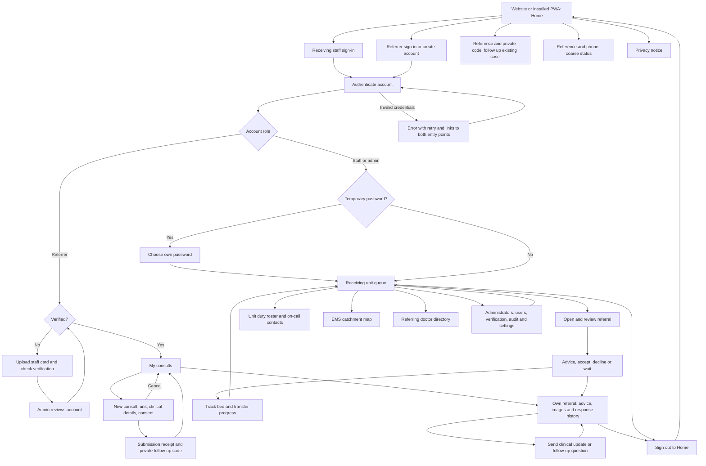

# BaraBridge user journeys

Updated 2026-10-26. Scope: entry, authentication, role selection, referrals,
receiving decisions, follow-up, administration, recovery and exit.



## Navigation contract

| Step | Entry and next action | Recovery or exit |
| --- | --- | --- |
| 1. Home / installed app | Choose receiving staff or referring clinician; signed-in users can continue to their workspace | Both entry paths stay visible |
| 2. Either sign-in form | Credentials determine the workspace, regardless of the form used | Error stays beside the form; Home and other sign-in always reachable |
| 3. Referrer registration | HPCSA identity match verifies automatically; otherwise upload staff card for admin review | Pending users can check status, browse roster, sign out or return Home; new submissions blocked |
| 4. Staff first sign-in | Temporary password requires a new password before the desk | Sign out and public navigation remain available |
| 5. New consult | Verified referrer selects MEU/TEU/SEU and enters required information | Back to My consults; validation error preserves form |
| 6. Receipt | Reference and private follow-up code; return to My consults or start another consult | Never resubmit just to get back to the dashboard |
| 7. Own case | Read response history and images; send updates to the team | Close details returns to My consults; loading failure offers retry |
| 8. Receiving desk | Queue, case, advice/decision, transfer progress; labelled tabs for roster and other staff tools | Close case returns to queue; header stays visible |
| 9. Admin | Users, pending referrers, audit and data settings according to role | Queue tab returns to desk; non-admin gets a recovery link |
| 10. Existing referral links | Old `/refer` and `/refer/UNIT` enter account portal; unit preset survives sign-in | Public follow-up and coarse status remain available with their credentials |
| 11. Session restore / expiry | One active account and shared expiry handling for both workspaces | Bounded restore, retry or sign in again; expiry clears both old storage keys |
| 12. Unknown URL | Explain missing page | Home and both role entry links |

## Causes and checks

```text
No public navigation ------\
  Referrer login only had privacy link \
Wrong-form rejection ------+--> Users get stranded or sent in circles
  Valid staff login rejected by portal /
Separate session owners --/
  Staff restore and referrer restore competed for one API token
Staff-only case API ------/
  Referrer details could not load; no account-based update path
Icon-only phone tabs -----/
  Queue destination was not clear without its label
```

These factors were confirmed in the checkout and the live referrer entry's
accessibility tree. In-app screenshot capture failed, so baseline visual
claims are limited. Local browser checks use synthetic accounts and the real
client and route handlers, with database operations replaced by an in-memory
fixture. They do not contact Supabase or create patient records.

## Implementation and verification plan

1. Use one session owner; retain existing storage keys for compatibility and
   clear the other role's token when changing accounts. Do not add dependencies.
2. Share public navigation; keep staff tabs labelled on phones and add recovery
   for expired sessions, failed loads, wrong roles and missing pages.
3. Give referrers dedicated APIs for their own details, images and follow-up.
   Other users' cases return 404; referrer viewing must not mark a case as
   opened by receiving staff.
4. Check type safety, submission and ownership route tests, browser journeys
   at phone and desktop widths, and production build. Check the delivered live
   links after deployment. No real patient record is needed for these checks.
5. Deploy a versioned release after checking active work. Keep the previous
   release and runtime configuration available; restore its symlink and service
   if live health or navigation fails. No database migration is involved.

## Limits

- Delivery of notifications, external catchment availability, manual clinical
  decisions and real staff-card review are separate operational checks.
- Referrer facility and department are still entered on each consult; the current
  database profile does not persist those two fields, so signup no longer asks
  for them. Other saved profile details prefill the form. The UI does not promise
  complete profile autofill.
- A complete clinical acceptance test with receiving teams is still required
  before treating the pilot as ready for clinical use.

## Verification record

The production client was built and exercised in a local Chromium browser at
390 x 844 and 1280 x 900. The real Express handlers ran against the isolated
in-memory database fixture. The browser checks cover wrong-entry sign-in in both
directions, persistent sessions, cancellation and retry of session restoration,
expiry, verification gating, referral submission, private receipt, own-case
updates, receiving-team advice returned to the original referrer, admin access,
and first-login password change. The UX Pilot implementation adds checks for
three-step referral validation and preserved fields, two-stage signup, successful
card-upload feedback, and urgent-first queue ordering. No browser runtime errors
were reported.

Saved evidence is in `artifacts/navigation-audit/` (ignored by Git): screenshots
02 through 14, form/onboarding screenshots and `checks.json`. API tests additionally prove foreign-case and
foreign-image access is refused, referrer viewing does not count as staff
opening a case, and late failures from a previous account cannot expire a new
session. TypeScript checks and the production build are required before release.
